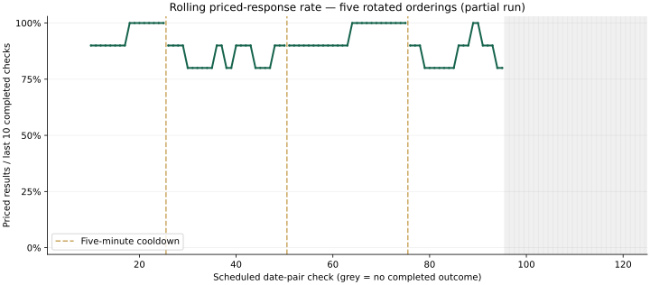
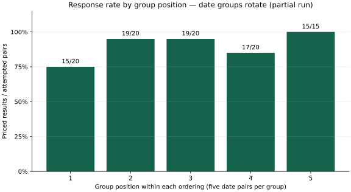

# Repeated-search deterioration experiment — 20 October 2026

This experiment checks whether priced-response rates decline as queries accumulate,
while rotating the same date groups through different positions. It is a balanced
repeated-order experiment, not machine-learning cross-validation.

## Protocol

- 25 distinct LIM→MIL date pairs: departures 10–14 December 2026, stays 14–18 days.
- Five groups A–E, one per departure; five chronological return dates per group.
- Five orders: ABCDE, BCDEA, CDEAB, DEABC, EABCD. Each group appears once in each position.
- US `iad1`, browser-compatible HTTP fetching, a new shared Google session per ordering.
- 1.5-second minimum query-start interval; 300-second pauses between orderings.
- One adult, economy, EUR, 0–2 outbound layovers, 20 offers, self-transfers/separate tickets excluded.
- No browser fallback, automatic retries, or other automated flight-search experiments during the run.

Deployment pinned to `17425f94bb40892c47a33b467ad45b3ec9cc3c1e` throughout.
The advertised plan, actual query order, execution region, revision, session index,
pacing configuration, timestamps and request counters are checked by the runner.

The normal website retains chronological ordering and a three-consecutive-error
stop. Only explicit experiment requests (at most 25 pairs) may continue through
recognized Google generic errors in HTTP 200. Other provider/transport/parser
failures stop the entire experiment; unattempted pairs remain pending.

Verification before deployment: 83 Python tests and all three JavaScript suites
passed. Tests cover ordering, validation, bounded error continuation, unchanged
normal behavior, fatal stops, interruption/cancellation, counters, partial charts
and denominator handling. The report uses local matplotlib; production dependency
requirements were unchanged.

## Interpretation limits

Priced responses / completed attempts is the primary rate. Valid unpriced responses
are reported separately; neither failed nor empty responses establish absent
flights. Pending/interrupted queries are excluded from rate denominators.

Position comparisons rotate the same date pairs to reduce date-difficulty bias.
An association with position or cumulative activity would not prove throttling:
Google cache warming, changing upstream responses and unrelated production traffic
are possible confounders. The pauses and session renewals occur together, so their
effects cannot be separated. Vercel may assign different workers/egress addresses
to separate orderings; a fixed region does not guarantee a fixed IP. Five
orderings are not 125 independent experimental replications, and this protocol
cannot establish what happens in a continuous 125-query run without pauses.

## Partial results — experiment interrupted

The controlling process ended during ordering 4. Raw events and file timestamps
confirm 95 completed outcomes, one query whose outcome was not received, and 29
pending queries. No ordering-4 terminal event or ordering-5 request exists. The
original state file was backed up before reconciling its stale `running` status.
No automatic continuation was attempted: a later run cannot preserve the planned
five-minute interval. The original raw NDJSON remains unchanged locally.

| Ordering | Completed | Priced | Errors | Interrupted | Pending | Priced rate |
| --- | ---: | ---: | ---: | ---: | ---: | ---: |
| ABCDE | 25 | 24 | 1 | 0 | 0 | 96% |
| BCDEA | 25 | 21 | 4 | 0 | 0 | 84% |
| CDEAB | 25 | 24 | 1 | 0 | 0 | 96% |
| DEABC — partial | 20 | 16 | 4 | 1 | 4 | 80% |
| EABCD — unattempted | 0 | 0 | 0 | 0 | 25 | Not observed |

Totals: **85 priced / 95 completed outcomes (89.5%)**, 10 generic Google errors,
no valid unpriced outcomes. All observed errors were HTTP 200 generic query
failures, not evidence that flights were unavailable. The interrupted query is
excluded from the denominator; it may have executed upstream without delivering
an observable result.

The three complete orderings show no steady decline (96%, 84%, 96%). The partial
fourth ordering scored 80%, but the missing final group and fifth rotation prevent
completing the planned balanced comparison. First-group positions yielded 15/20
priced, compared with 15/15 for observed last-group positions; these denominators
are unequal. Among the ten date pairs observed both first and last, 8 were priced
early and 10 late. These partial data do not establish a deterioration effect or
prove its absence.

Artifacts: [observations CSV](experiments/five-order-2026-10-20/observations.csv),
[protocol and deployment metadata](experiments/five-order-2026-10-20/protocol.json),
and [machine-readable analysis](experiments/five-order-2026-10-20/analysis.json).
Raw NDJSON, full manifest, reconciliation backup and generated report remain in
ignored local `work/diagnostics/five-order-2026-10-20/`.

A follow-up change adds terminal-hangup (SIGHUP) handling to the local runner and
explicit partial-run chart titles. All nine focused experiment tests pass after
that change, including end-to-end cancellation persistence and signal-handler
restoration. This does not alter the deployment used for the recorded searches.
